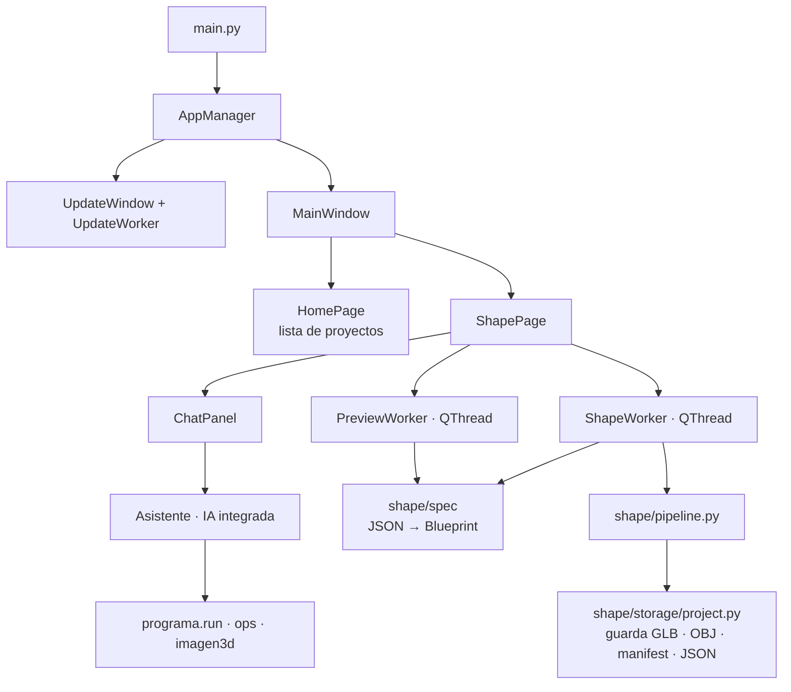

[⬅ README](../README.md)

# 🧱 Arquitectura

PySide6 (Qt 6) + numpy + Pillow, empaquetado en un único `.exe` con PyInstaller.



| Capa | Carpeta | Responsabilidad |
|---|---|---|
| Entrada | `main.py` | Logs, `excepthook`, AppUserModelID, tema y arranque |
| Interfaz | `app/gui` | Widgets y estilos, sin lógica de negocio |
| Managers | `app/managers` | Orquestan y lanzan hilos (`QThread`) por señales |
| IA | `app/ai` | Modelo, programa, piezas y registro (sin Qt, sin red) |
| Dominio | `app/shape` | JSON → Blueprint → 3D con numpy (sin Qt salvo el visor) |
| Utilidades | `app/utils` | Rutas, logs, JSON, descargas, zip, hilos, actualización |
| Recursos | `app/assets` | Logo, `update.ps1` y el modelo de la IA |

**Principios**: todo lo pesado en hilos · dominio e IA sin Qt · datos de usuario fuera del bundle · una sola textura por objeto · la IA decide, las piezas construyen · el JSON es la única fuente de verdad del objeto.

## 📁 Estructura

```
JanusApp/
├── .github/workflows/build_release.yml
├── app/
│   ├── assets/        logo.ico · logo.png · scripts/update.ps1 · ia/janus_ia.npz
│   ├── ai/
│   │   ├── fast/        asistente · modelo · programa · texto · colores · imagen3d · registro
│   │   └── assistant/   ops · ejemplos · vision        (las piezas con las que construye la IA)
│   ├── gui/           main_window · home_page · shape_page · ai_chat · widgets · viewer · theme · update_window
│   ├── managers/      app_manager · shape_manager · update_manager
│   ├── shape/
│   │   ├── spec/        schema · raster · blueprint · preview · marks      (JSON → siluetas, colores, marcas)
│   │   ├── geometry/    primitive · protrusion · ellipsoid · relief · opening · field · cut · qem · surface_nets · mesh_ops · coords
│   │   ├── texture/     atlas · interior
│   │   ├── rig/         skeleton
│   │   ├── storage/     export · project
│   │   └── pipeline · model · render
│   └── utils/         paths · logger · json · download · zip · callback · pool · mask · update  (*_util.py)
├── docs/
├── main.py · JanusApp.spec · requirements.txt · version.json
└── testing/           (ignorada por git) objetos de prueba y entrenamiento de la IA
```

Generados al ejecutar (ignorados por git): `app/logs/` (incluye `ia/peticiones.jsonl`) · `app/projects/` · `app/settings/` · `temp_download/` · `_backup/` · `build/` · `dist/`.

## 🧭 Dónde tocar

| Quiero… | Archivo |
|---|---|
| Añadir una sección a la barra lateral | `gui/main_window.py` (`SECTIONS`) |
| Cambiar el chat | `gui/ai_chat.py` |
| Cambiar colores o estilos | `gui/theme.py` |
| Cambiar la lista de proyectos de Inicio | `gui/home_page.py` |
| Añadir una orden a la IA | `ai/fast/programa.py` (+ piezas en `ai/assistant/ops.py`) y reentrenar |
| Cambiar las plantillas de objeto | `ai/assistant/ejemplos.py` |
| Construir objetos desde imágenes | `ai/fast/imagen3d.py` |
| Cambiar el formato del JSON | `shape/spec/schema.py` (+ `raster.py` si se dibuja distinto) |
| Cambiar el tallado | `shape/spec/raster.py` (`carve`) |
| Cambiar cómo se genera la forma | `shape/pipeline.py` |
| Cambiar relieves (cadena, cuerda, pieza…) | `shape/geometry/relief.py` |
| Cambiar los salientes | `shape/geometry/protrusion.py` |
| Operaciones sobre máscaras (dilatar, erosionar, rellenar, etiquetar) | `utils/mask_util.py` |
| Orientación de las vistas respecto a los ejes | `shape/geometry/field.py` (`view_targets`) |
| Cambiar qué se guarda en disco | `shape/storage/project.py`, `shape/storage/export.py` |
| Cambiar rutas o la URL de releases | `utils/paths_util.py` |
| Cambiar la actualización | `utils/update_util.py`, `assets/scripts/update.ps1` |

## 🪟 Interfaz (`app/gui`)

| Archivo | Contenido |
|---|---|
| `main_window.py` | `SECTIONS` (Inicio, Forma, Texturas, Colisión, Esqueleto, Visor 3D), barra lateral de 220 px, `QStackedWidget`, `notify()`; al cerrar, `ShapePage.shutdown()` |
| `home_page.py` | Tarjetas de versión y lista de proyectos con miniatura (renderizadas una a una para no bloquear); señal `edit_requested` |
| `shape_page.py` | Pantalla *Forma*: chat (430 px) + visor, LODs, apertura, esqueleto, información; vista previa y generación en hilos; edita proyectos existentes |
| `ai_chat.py` | `ChatPanel`: burbujas, chips, adjuntos (diálogo y arrastrar), vista previa y **Generar** dentro de la respuesta, Deshacer, Nuevo, Bien/Mal y registro |
| `widgets.py` | `make_card`, `page_layout`, `icon_button` y componentes comunes |
| `viewer.py` | `MeshViewer` (visor por software) y `render_thumbnail` |
| `theme.py` | Paleta `COLORS` y QSS por `objectName` (burbujas, chips…) |
| `update_window.py` | Ventana de arranque/actualización (sin marco, no se puede cerrar hasta terminar) |

## 🧵 Managers

| Clase | Señales | Función |
|---|---|---|
| `AppManager` | — | Crea `UpdateWindow` y `UpdateWorker`; abre `MainWindow` (idempotente); cierra la app para completar una actualización |
| `UpdateWorker` | `update_found` · `progress` · `restart` · `failed` · `done` | Comprueba y aplica la actualización (se omite si no es el `.exe`) |
| `PreviewWorker` | `done(dict)` · `failed(str)` | JSON → Blueprint → vista previa (vistas, cuadrícula con marcas, interiores) |
| `ShapeWorker` | `progress(float,str)` · `finished_ok(result, carpeta)` · `failed(str)` | JSON → Blueprint → `generate_shape` → `save_shape`; errores del JSON tal cual, el resto con traza en el log |

La IA **no usa hilos**: responde en ~10 ms, de forma síncrona. Si se cierra la ventana o se pulsa *Nuevo* mientras un hilo trabaja, el hilo queda «huérfano» (termina solo y ya no toca la interfaz).

## 🤖 IA (`app/ai`)

| Módulo | Contenido |
|---|---|
| `fast/asistente` | `Asistente.pedir(texto, objeto, adjuntos)` → `Resultado` (objeto, cambios, avisos, programa, tiempo, id); `palette()` saca colores de una imagen |
| `fast/modelo` | `FastModel`: transformer en numpy con caché; `generate(contexto, palabras)` |
| `fast/texto` | `prepare` (normaliza y extrae `#hex`/medidas), `Vocab` (erratas → palabra conocida) |
| `fast/programa` | `state` (fichas de contexto) y `run` (ejecuta el programa; solo cambia lo que se pidió) |
| `fast/colores` | Palabras de color (entrenamiento y comprobación) |
| `fast/imagen3d` | Imágenes → silueta + colores por vista → JSON |
| `fast/registro` | `peticiones.jsonl` |
| `assistant/ops` | Piezas: `band_by`, `convert_reliefs`, `add_ornament`, `carve_texture`, `apply_ops`… |
| `assistant/ejemplos` | Plantillas *esfera simple* y *esfera con banda y botón* |

## 🧰 Utilidades (`app/utils`)

| Módulo | Contenido |
|---|---|
| `paths_util` | Todas las rutas y URLs; `IS_FROZEN`, `BASE_DIR`, `USER_DATA_DIRS`, `FAST_MODEL`, `IA_LOG_PATH` |
| `logger_util` | Log rotativo (5 MB × 3), `excepthook`, `shutdown_logs` |
| `json_util` | `parse_json` (tolera BOM), `read_json`, `save_json` |
| `download_util` | `http_get`, `download_file` (a `.part`, comprueba tamaño) |
| `zip_util` | `unzip_file` con progreso |
| `callback_util` | `invoke_progress` (nunca propaga excepciones) |
| `pool_util` | `parallel_map`, `parallel_dict` (hasta 8 hilos) |
| `mask_util` | Máscaras booleanas de cualquier dimensión: `grow`, `dilate`, `erode`, `border`, `flood` (relleno desde semillas) y `label` (componentes conexas). Las comparten `imagen3d`, `malla3d`, `asistente`, `pipeline` y `protrusion` |
| `update_util` | Lógica de actualización |
