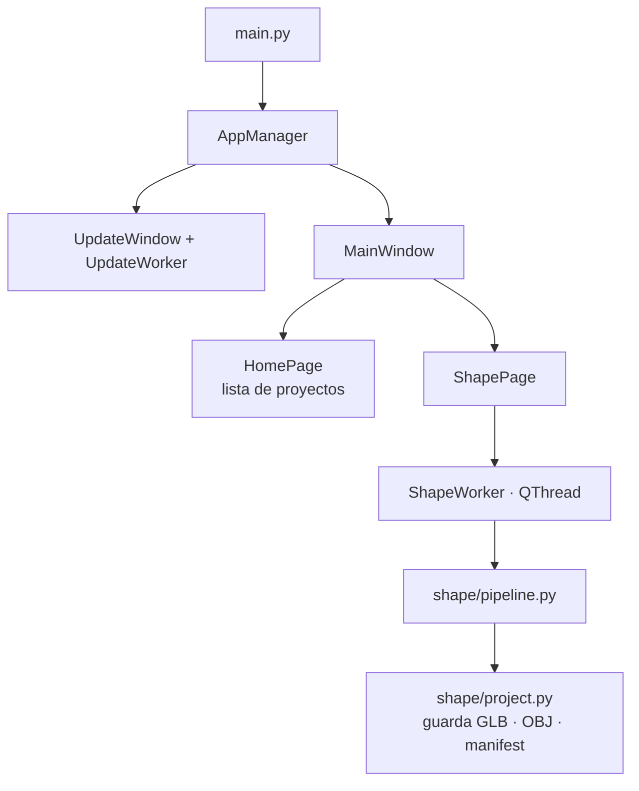

[⬅ README](../README.md)

# 🧱 Arquitectura

PySide6 (Qt 6) + numpy + Pillow, empaquetado en un único `.exe` con PyInstaller.



| Capa | Carpeta | Responsabilidad |
|---|---|---|
| Entrada | `main.py` | Logs, `excepthook`, AppUserModelID, tema y arranque |
| Interfaz | `app/gui` | Widgets y estilos, sin lógica de negocio |
| Managers | `app/managers` | Orquestan y lanzan hilos (`QThread`) por señales |
| Dominio | `app/shape` | Generación 3D con numpy (sin Qt salvo el visor) |
| Utilidades | `app/utils` | Rutas, logs, JSON, descargas, zip, actualización |
| Recursos | `app/assets` | Logo y `update.ps1` |

**Principios**: todo lo pesado en hilos · dominio sin Qt · datos de usuario fuera del bundle · una sola textura por objeto.

## 📁 Estructura

```
JanusApp/
├── .github/workflows/build_release.yml
├── app/
│   ├── assets/        logo.ico · logo.png · scripts/update.ps1
│   ├── gui/           main_window · home_page · shape_page · widgets · viewer · theme · update_window
│   ├── managers/      app_manager · shape_manager · update_manager
│   ├── shape/         pipeline · preprocess · metric · opening · field · primitive · protrusion · ellipsoid
│   │                  atlas · interior · cut · qem · surface_nets · mesh_ops · model · naming
│   │                  export · project · render
│   └── utils/         paths · logger · json · download · zip · callback · update  (*_util.py)
├── docs/
├── main.py · JanusApp.spec · requirements.txt · version.json
└── testing/           (ignorada por git) imágenes y entornos de prueba
```

Generados al ejecutar (ignorados por git): `app/logs/` · `app/projects/` · `app/settings/` · `temp_download/` · `_backup/` · `build/` · `dist/`.

## 🧭 Dónde tocar

| Quiero… | Archivo |
|---|---|
| Añadir una sección a la barra lateral | `gui/main_window.py` (`SECTIONS`) |
| Cambiar colores o estilos | `gui/theme.py` |
| Cambiar la lista de proyectos de Inicio | `gui/home_page.py` |
| Cambiar cómo se genera la forma | `shape/pipeline.py` |
| Cambiar los salientes | `shape/protrusion.py` |
| Cambiar qué se guarda en disco | `shape/project.py`, `shape/export.py` |
| Cambiar rutas o la URL de releases | `utils/paths_util.py` |
| Cambiar la actualización | `utils/update_util.py`, `assets/scripts/update.ps1` |

## 🪟 Interfaz (`app/gui`)

| Archivo | Contenido |
|---|---|
| `main_window.py` | `SECTIONS` (Inicio, Forma, Texturas, Colisión, Esqueleto, Visor 3D), barra lateral de 220 px, `QStackedWidget`, `notify()` |
| `home_page.py` | Tarjetas de versión y lista de proyectos con miniatura (renderizadas una a una para no bloquear); señal `edit_requested` |
| `shape_page.py` | Pantalla *Forma*: 6 `ViewPair` + interior, generar, visor, LODs, apertura, información; edita proyectos existentes |
| `widgets.py` | `Preview` (botón +, papelera, arrastrar y soltar), `ViewPair`, `make_card`, `page_layout`, `icon_button` |
| `viewer.py` | `MeshViewer` (visor por software) y `render_thumbnail` |
| `theme.py` | Paleta `COLORS` y QSS por `objectName` |
| `update_window.py` | Ventana de arranque/actualización (sin marco, no se puede cerrar hasta terminar) |

## 🧵 Managers

| Clase | Señales | Función |
|---|---|---|
| `AppManager` | — | Crea `UpdateWindow` y `UpdateWorker`; abre `MainWindow` (idempotente); cierra la app para completar una actualización |
| `UpdateWorker` | `update_found` · `progress` · `restart` · `failed` · `done` | Comprueba y aplica la actualización (se omite si no es el `.exe`) |
| `ShapeWorker` | `progress(float,str)` · `finished_ok(result, carpeta)` · `failed(str)` | `generate_shape` → `save_shape`; errores con traza en el log |

## 🧰 Utilidades (`app/utils`)

| Módulo | Contenido |
|---|---|
| `paths_util` | Todas las rutas y URLs; `IS_FROZEN`, `BASE_DIR`, `USER_DATA_DIRS` |
| `logger_util` | Log rotativo (5 MB × 3), `excepthook`, `shutdown_logs` |
| `json_util` | `parse_json` (tolera BOM), `read_json`, `save_json` |
| `download_util` | `http_get`, `download_file` (a `.part`, comprueba tamaño) |
| `zip_util` | `unzip_file` con progreso |
| `callback_util` | `invoke_progress` (nunca propaga excepciones) |
| `update_util` | Lógica de actualización |
