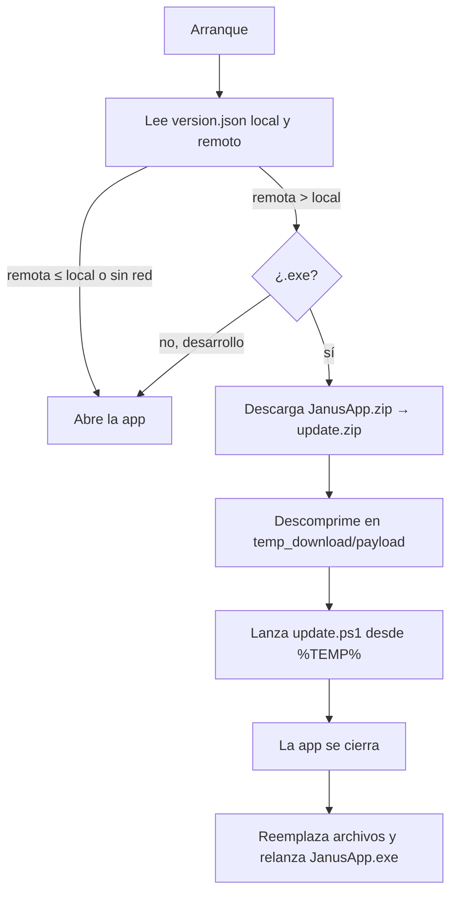

[⬅ README](../README.md)

# 🛠️ Desarrollo

## 💻 Entorno

Windows · Python **3.11** · Git.

```powershell
git clone https://github.com/BranBPDev/JanusApp.git
cd JanusApp
python -m venv .venv
.venv\Scripts\activate
pip install -r requirements.txt
python main.py
```

| Paquete | Versión |
|---|---|
| PySide6 | `>=6.7,<7` |
| pyinstaller | `>=6.6` |
| pillow | `>=10` |
| numpy | `>=1.26,<3` |

En desarrollo (`IS_FROZEN = False`): `BASE_DIR` es la raíz del repo, la versión se lee de `version.json`, **no se actualiza** y los logs salen también por consola. `testing/` está ignorada por git y por el workflow. Depura con `app/logs/janus.log` (`CRASH` = excepción no capturada).

## 📐 Convenciones

| Tema | Regla |
|---|---|
| Capas | `gui` solo widgets · `managers` hilos y señales · `shape` dominio sin Qt · `utils` un tema por `*_util.py` |
| Hilos | Todo lo largo en un `QThread` con `progress(float,str)`, `finished_ok`/`done`, `failed(str)` |
| Estilos | Por `objectName` desde `theme.py`; colores de `COLORS`; nada en línea |
| Datos de usuario | Bajo `app/` y en `USER_DATA_DIRS`; rutas **solo** en `paths_util.py` |
| Errores | `get_logger("NOMBRE")`, `exc_info=True`; validación de dominio con `ValueError` legible |
| Estilo | Textos y logs en español · docstrings breves con unidades y ejes · constantes en mayúsculas arriba · tipado ligero |

**Añadir una fase**: 1) `(clave, texto)` en `SECTIONS` y su página · 2) worker en `app/managers/` · 3) clave en `PHASES` (`project.py`) · 4) documentarla y enlazarla desde el README.

## 📦 Compilar

```powershell
pyinstaller --clean --noconfirm JanusApp.spec
```

Genera `dist/JanusApp.exe`: *onefile*, sin consola, icono `app/assets/logo.ico`, incluye `app/assets`, excluye `tkinter`, `numpy.f2py` y `PIL.ImageTk` y recorta componentes de Qt sin uso (QML, Quick, PDF, SVG, `opengl32sw.dll`, traducciones…).

## 🚢 Publicar una versión

`version.json`:

| Bloque | Uso |
|---|---|
| `configs` | `tag`, `name`, `description`, `prerelease`, `make_latest`, `branch` → lo lee el workflow (no se distribuye) |
| `userjson` | `name`, `version`, `releaseDate`, `author`, `repository` → es `app/data/version.json` en la app |

1. Sube `configs.tag`, `configs.name`, `userjson.version`, `userjson.releaseDate` y la descripción.
2. Commit y push a `main`.
3. El workflow compila y publica; los clientes se actualizan al abrir.

> [!NOTE]
> Un push que solo toque `*.md` o `testing/**` **no** lanza release.

**Workflow `build_release.yml`** (`windows-latest`, concurrencia `release` con cancelación): checkout → Python 3.11 con caché → `pip install` → lee `version.json` y lo reescribe solo con `userjson` → PyInstaller → `JanusApp.zip` (`JanusApp.exe` + `app/data/version.json`, sin compresión) → `softprops/action-gh-release@v2` con `JanusApp.zip` y `version.json` (`overwrite`). Permiso `contents: write`.

## 🔄 Actualización automática



- `parse_version("v1.2.3")` → `(1,2,3,0)` (hasta 4 números: `1.10 > 1.9`). Acepta el `version.json` completo o el limpio de la release.
- Descarga a `update.zip.part`; solo se renombra al terminar y coincidir el tamaño. Si falla se borra `temp_download/`.
- `update.ps1` (`-ProcId -BaseDir -StagingDir -DownloadDir -ExePath -LogPath -Keep`): espera hasta 60 s al proceso → crea `_backup/` → mueve lo que se reemplaza (conserva `logs`, `projects`, `settings`) → copia `payload` → borra `_backup/` y `temp_download/` → relanza. **Si falla**, restaura la copia y relanza igualmente. Reintenta cada operación 20 × 500 ms y escribe en `janus.log` con `[PS_UPDATER]`.
- Cierre: `quit()` a los 800 ms y `os._exit(0)` a los 3000 ms; antes se cierran los logs y se limpian `_MEIPASS*` / `_PYI*` del entorno.

> [!IMPORTANT]
> Para que los usuarios reciban una actualización hay que **subir la versión** en `version.json`.
