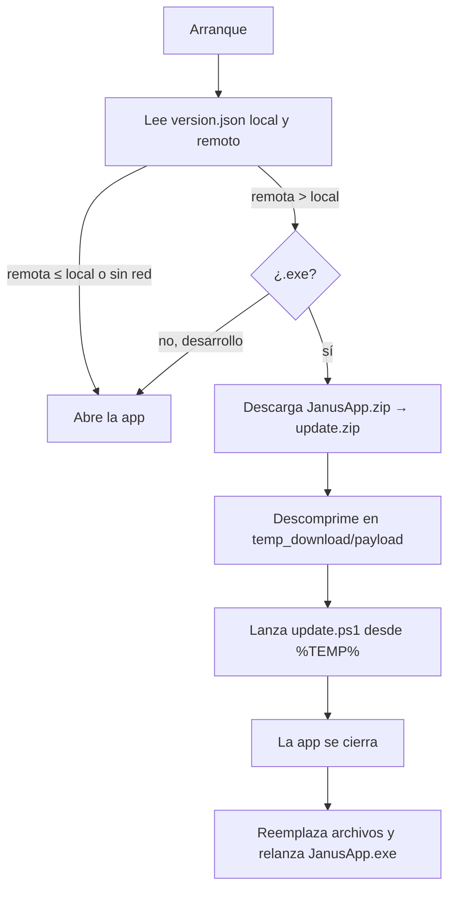

[⬅ README](../README.md)

# 🛠️ Desarrollo

## 💻 Entorno

Windows · Python **3.11** · Git.

```powershell
git clone https://github.com/BranBPDev/JanusApp.git
cd JanusApp
python -m venv .venv
.venv\Scripts\activate
pip install -r requirements.txt
python main.py
```

| Paquete | Versión |
|---|---|
| PySide6 | `>=6.7,<7` |
| pyinstaller | `>=6.6` |
| pillow | `>=10` |
| numpy | `>=1.26,<3` |

La IA y el dominio solo usan numpy + Pillow (sin torch, sin red). En desarrollo (`IS_FROZEN = False`): `BASE_DIR` es la raíz del repo, la versión se lee de `version.json`, **no se actualiza** y los logs salen también por consola. `testing/` está ignorada por git y por el workflow. Depura con `app/logs/janus.log` (`CRASH` = excepción no capturada).

## 📐 Convenciones

| Tema | Regla |
|---|---|
| Capas | `gui` solo widgets · `managers` hilos y señales · `ai` y `shape` sin Qt · `utils` un tema por `*_util.py` |
| Hilos | Todo lo largo en un `QThread` con `progress(float,str)`, `finished_ok`/`done`, `failed(str)`. La IA responde en ms y no usa hilos |
| Estilos | Por `objectName` desde `theme.py`; colores de `COLORS`; nada en línea |
| Datos de usuario | Bajo `app/` y en `USER_DATA_DIRS`; rutas **solo** en `paths_util.py` |
| Errores | `get_logger("NOMBRE")`, `exc_info=True`; validación con `SpecError`/`ValueError` de mensaje legible |
| Estilo | Textos y logs en español · docstrings breves con unidades y ejes · constantes en mayúsculas arriba · tipado ligero |
| Código común | Lo repetido vive en un solo sitio: máscaras en `utils/mask_util.py`, orientación de vistas en `field.view_targets`, color del interior en `atlas.interior_color`, aristas en `mesh_ops._edge_keys` |
| Paquetes | **Sin `__init__.py`**: el proyecto usa paquetes de espacios de nombres y `JanusApp.spec` recoge los módulos con `collect_submodules('app')` |
| Compatibilidad | El workflow compila con **Python 3.11**: nada de sintaxis de 3.12 (por ejemplo, f-strings con las mismas comillas anidadas). Un módulo con error de sintaxis se pierde en el `.exe` y la app falla al importarlo |

**Añadir una fase**: 1) `(clave, texto)` en `SECTIONS` y su página · 2) worker en `app/managers/` · 3) clave en `PHASES` (`storage/project.py`) · 4) documentarla y enlazarla desde el README.

## 🧪 Pruebas

| Comando | Qué hace |
|---|---|
| `python testing/probar_objeto.py testing/objetos/pokeball.json [salida]` | Interpreta un JSON, calcula el modelo y guarda `vista_previa.png` y los GLB |
| `python testing/ia/probar_rapido.py [modelo.npz]` | Acierto de la IA en ejemplos nuevos, peticiones escritas a mano (compara los **objetos** resultantes) y tiempos |
| `python testing/ia/desde_logs.py peticiones.jsonl` | Resumen de un registro de la IA (fallos y correcciones) |

`testing/objetos/` guarda objetos de ejemplo (esferas, starterball con cuerda, triskel tallado…).

## 🧠 Entrenar la IA

Todo es numpy puro (retropropagación escrita a mano; `gradcheck` comprueba el gradiente antes de entrenar).

```powershell
python testing/ia/entrenar.py [pasos] [salida.npz] [pesos_previos.npz] [lr] [semilla]
python testing/ia/entrenar.py 2000 salida.npz app/assets/ia/janus_ia.npz 1.5e-3 21     # continuar desde los pesos actuales
```

- Los ejemplos salen de `testing/ia/datos.py`: un generador de peticiones en español (con erratas, sinónimos y frases largas) + estado del objeto → programa. Cada **intención** es una función (`i_color`, `i_adorno`, `i_tallar`, `i_starter`, `i_desde_imagenes`, `i_recolor_desc`…).
- Si cambia el vocabulario, el entrenamiento arranca desde los pesos previos remapeando las fichas (*warm start*).
- Guarda un punto cada 500 pasos. A ~1,4 s por paso, 2000 pasos son ~45 min en dos núcleos. El proceso debe seguir vivo hasta acabar.
- Después, `probar_rapido.py` y copiar el `.npz` a `app/assets/ia/janus_ia.npz`.

**Reentrenar con casos reales**: 1) pide el `peticiones.jsonl` de `app/logs/ia/` · 2) mira las líneas `peticion` con `ok: false` y las `valoracion` con `correccion` · 3) añade al generador la frase y el programa correcto (o una intención nueva) · 4) reentrena y comprueba que los casos pasan.

**Añadir una orden**: 1) ejecutarla en `ai/fast/programa.py` (y la geometría en `ai/assistant/ops.py`) · 2) generarla en `datos.py` · 3) si el contexto cambia, una ficha nueva en `programa.state` · 4) reentrenar.

## 📦 Compilar

```powershell
pyinstaller --clean --noconfirm JanusApp.spec
```

Genera `dist/JanusApp.exe`: *onefile*, sin consola, icono `app/assets/logo.ico`, incluye `app/assets` (con el modelo de la IA, ~1,2 MB), excluye `tkinter`, `numpy.f2py` y `PIL.ImageTk` y recorta componentes de Qt sin uso (QML, Quick, PDF, SVG, `opengl32sw.dll`, traducciones…).

## 🚢 Publicar una versión

`version.json`:

| Bloque | Uso |
|---|---|
| `configs` | `tag`, `name`, `description`, `prerelease`, `make_latest`, `branch` → lo lee el workflow (no se distribuye) |
| `userjson` | `name`, `version`, `releaseDate`, `author`, `repository` → es `app/data/version.json` en la app |

1. Sube `configs.tag`, `configs.name`, `userjson.version`, `userjson.releaseDate` y la descripción.
2. Commit y push a `main` (o ejecuta el workflow a mano: `workflow_dispatch`).
3. El workflow compila y publica; los clientes se actualizan al abrir.

> [!NOTE]
> Un push que solo toque `*.md` o `testing/**` **no** lanza release.

**Workflow `build_release.yml`** (`windows-latest`, concurrencia `release` con cancelación): checkout → Python 3.11 con caché → `pip install` → lee `version.json` y lo reescribe solo con `userjson` → PyInstaller → `JanusApp.zip` (`JanusApp.exe` + `app/data/version.json`, sin compresión; **ligero**: no se descarga ningún modelo) → `softprops/action-gh-release@v2` con `JanusApp.zip` y `version.json` (`overwrite`). Permiso `contents: write`.

## 🔄 Actualización automática



- `parse_version("v1.2.3")` → `(1,2,3,0)` (hasta 4 números: `1.10 > 1.9`). Acepta el `version.json` completo o el limpio de la release.
- Descarga a `update.zip.part`; solo se renombra al terminar y coincidir el tamaño. Si falla se borra `temp_download/`.
- `update.ps1` (`-ProcId -BaseDir -StagingDir -DownloadDir -ExePath -LogPath -Keep`): espera hasta 60 s al proceso → crea `_backup/` → mueve lo que se reemplaza (conserva `logs`, `projects`, `settings`) → copia `payload` → borra `_backup/` y `temp_download/` → relanza. **Si falla**, restaura la copia y relanza igualmente. Reintenta cada operación 20 × 500 ms y escribe en `janus.log` con `[PS_UPDATER]`.
- Cierre: `quit()` a los 800 ms y `os._exit(0)` a los 3000 ms; antes se cierran los logs y se limpian `_MEIPASS*` / `_PYI*` del entorno.

> [!IMPORTANT]
> Para que los usuarios reciban una actualización hay que **subir la versión** en `version.json`.
