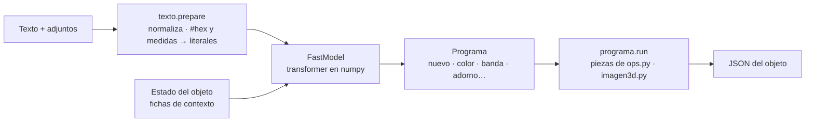

[⬅ README](../README.md)

# 🤖 IA integrada

Un modelo de lenguaje **muy pequeño** (≈ 1,2 MB) que viaja dentro del `.exe` (`app/assets/ia/janus_ia.npz`). Se ejecuta en la CPU con numpy, tarda **~10 ms** por petición y no necesita internet, tokens ni descargas.

**La IA decide; la aplicación construye.** El modelo no escribe el JSON a mano: escribe un *programa* de pocas fichas (qué piezas y qué parámetros) y la aplicación lo ejecuta con la geometría exacta del formato (centrar la esfera, dejar margen a los relieves, igualar el grosor de la banda, etc.).

## 🧠 El modelo

| | |
|---|---|
| Arquitectura | Transformer solo decodificador: dim 128 · 4 cabezas · 3 capas · ff 512 · contexto 176 · pesos atados · posiciones aprendidas |
| Vocabulario | ≈ 520 fichas (palabras, colores, órdenes) |
| Pesos | float16 en un `.npz` (~1,2 MB) |
| Inferencia | Caché de claves/valores, decodificación voraz restringida a fichas del programa; `confianza` = la menor probabilidad de una ficha (< 0,55 → aviso) |
| Erratas | Una palabra desconocida se sustituye por la conocida más parecida (`roka` → `roja`) |

Entrada del modelo: **fichas de contexto** (cómo es el objeto actual: `vacio`, `esfera_simple`, `esfera_banda`, `tiene_banda`, `tiene_cuerda`, `tiene_cadena`, `tiene_triskel`, `tiene_pinchos`, `tiene_adorno`, `triskel_plano`, `tiene_tallado`, `objeto_libre`; y si hay adjuntos: `img`, `img_frente`, `img_lateral`, `img_hoja`) + las palabras de la petición. Los colores `#rrggbb` y las medidas («15 cm», «0,3 m», «20mm») no pasan por el modelo: se sustituyen por `<h0>…` y `<n0>…` y el programa los copia.

## 🧾 El programa

| Orden | Hace |
|---|---|
| `nuevo simple` · `nuevo banda` | Esfera de un color · esfera de dos mitades con banda y botón (con su **interior por defecto**) |
| `starter` | La **starterball**: `nuevo banda` + banda → cuerda azul marino (`#000080`) + tapa oliva (`#808000`) + fondo verde (`#008040`) con textura de mar + botón blanco + triskel tallado en la tapa. Lo que se nombre después lo cambia |
| `diam <n>` · `escalar xK` | Diámetro en metros · factor de tamaño |
| `color ZONA COL` | Zonas: `tapa fondo banda boton todo cuerda cadena triskel pinchos adorno` |
| `banda cuerda\|cadena [COL]` | Sustituye la banda por una cuerda/cadena del mismo grosor, con un aro que rodea el botón. Si ya la tiene, solo cambia el color |
| `a_cuerda` · `a_cadena [COL]` | Convierte las cadenas en cuerdas (o al revés) |
| `adorno FORMA [COL] [plano] [tallado\|tallado_relieve] [piedra\|madera] [tam <n>] [cant K]` | Formas: `triskel pinchos anillo bola cono cilindro` |
| `mar ZONA [COL]` | Textura de mar (celdas con líneas claras y sombra, como las cáusticas) en `fondo`, `tapa` o `cuerpo`; sin color conserva el actual |
| `tallar triskel [tallado\|tallado_relieve] [piedra\|madera] [COL]` | Talla el triskel dibujado en la tapa (si no hay, lo crea) |
| `quitar adornos\|cuerdas\|cadenas` | Quita relieves |
| `desde_imagenes [alto <n>]` | Construye el objeto a partir de las imágenes adjuntas |
| `pedir_imagenes` | «Eso no lo hago con mis piezas»: pide imágenes o un JSON |
| `fin` | Fin del programa |

Colores: 15 base (`rojo azul verde amarillo naranja morado rosa negro blanco gris marron dorado plateado turquesa beige`) × normal / `_claro` / `_oscuro`, más los literales `<h0>…`.

### Solo cambia lo que pides

- Un color que la IA escribe y **no nombraste** se ignora (y se avisa en los cambios).
- Pedir «la cuerda roja» no toca el resto del objeto.
- Sobre un objeto que ya existe no se crea otro nuevo salvo que lo pidas («hazme…», «otra…»).

## 🪨 Texturas talladas

`tallado` dibuja la forma como **grabada** (hacia adentro) o en **relieve** (`tallado_relieve`, hacia afuera) sobre la textura, con bordes redondeados y sombra según la luz del objeto. Solo cambia el **brillo**: el material de la esfera (metal, etc.) y su acabado no se tocan.

- **Color por defecto = el de la superficie donde se talla** (la tapa). Si pides otro («tallado en rojo»), usa ese. Si luego cambias el color de la tapa, el tallado lo sigue mientras no hayas pedido otro.
- Grano opcional: `piedra` o `madera`.
- Se aplica a lo **dibujado en la textura** (el triskel plano). Un triskel que sobresale (geometría) no se talla: si pides «tallado», se dibuja en la tapa. El triskel es **una sola línea continua** (una capa `linea`), no tres espirales unidas: el tallado no deja costuras.
- En el JSON: `"tallado": {"tipo": "grabado|relieve", "profundidad", "ancho_m", "grano"}` en cualquier capa dibujada ([formato](objeto-json.md)).

## 🖼️ Objetos a partir de imágenes y archivos

Adjunta imágenes (PNG, JPG, JFIF, WEBP, BMP, GIF, TIF, TGA, SVG sencillo) y pide el objeto («hazme a …, te paso imágenes»). La IA elige `desde_imagenes`; la aplicación:

1. Asigna cada imagen a una **vista por el nombre del archivo**: `frente` / `front` / `defrente`, `lateral` / `izquierda` / `derecha` / `left` / `right` / `side`, `detras` / `back` / `trasera`, `arriba` / `top`, `abajo` / `bottom`.
2. Quita el fondo (transparencia, o el color del borde) y traza la **silueta** como polígono.
3. Agrupa los **colores** (hasta 6) y los coloca como manchas de polígonos sobre la silueta.
4. Ajusta las proporciones entre vistas con el mismo alto (por defecto **30 cm**; di «de 70 cm de alto» para otro).
5. Entrega un JSON normal: se previsualiza, se edita con el chat y se genera igual que cualquier objeto.

Reglas:

- Hacen falta **frente + una lateral**. Con una sola, la otra se estima (elipse) y se avisa.
- Una **hoja con varias vistas** (una sola imagen apaisada, fondo claro, vistas una al lado de otra) se separa sola: de izquierda a derecha frente, lateral izquierda, arriba, detrás y abajo (con menos vistas, las primeras). Las medidas salen de los píxeles de la hoja; sin altura se usa 0,3 m, así que di «de 70 cm de alto» (los números escritos en la imagen no se leen).
- Las imágenes **sin nombre de vista** rellenan «frente» y «lateral» si faltan; las demás se ignoran con un aviso.
- Fotos en perspectiva (3/4) no sirven como vista: la forma sale de siluetas planas.
- Un **JSON** adjunto se toma como objeto de partida («cambia esto…»).
- Un archivo de otro tipo no se lee: se avisa con su nombre.

Si adjuntas una imagen y pides una esfera con banda (por ejemplo «una pokeball como la imagen»), no se construye la forma de la imagen: se toman sus **colores** (tapa = el más vivo, fondo = el más claro, banda = el más oscuro, botón = el segundo más claro).

## 📝 Registro y reentrenamiento

Cada petición queda en `app/logs/ia/peticiones.jsonl` (una línea JSON por evento; rota a los 8 MB; se desactiva con la variable `JANUS_IA_SIN_REGISTRO`):

| `tipo` | Campos |
|---|---|
| `peticion` | `id`, `hora`, `texto`, `estado` (fichas de contexto), `programa` (lo que escribió la IA), `ok`, `error`, `confianza`, `cambios`, `avisos`, `adjuntos`, `ms`, `literales` |
| `valoracion` | `id`, `ok`, `correccion` (lo que querías, si pulsaste «Mal») |
| `deshacer` | `id` |

Pasa ese archivo para reentrenar con los casos reales ([Desarrollo](desarrollo.md#-entrenar-la-ia)).

## 🚧 Lo que no hace

- No inventa formas: construye con sus piezas (esferas, bandas, cuerdas, cadenas, adornos) o con las imágenes que le des.
- El tallado solo se aplica a lo dibujado en la textura.
- Convertir un triskel plano en relieve de geometría solo cambia su color.
- Una frase muy corta como «ahora un triskel … de 15 cm» puede leer los 15 cm como el tamaño del objeto en vez del triskel.
- Los archivos 3D (`.glb`, `.obj`) no se leen todavía como entrada.
