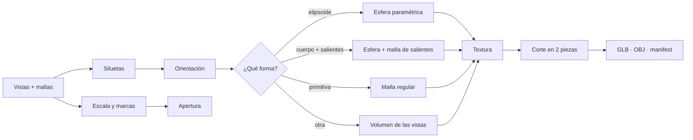

[⬅ README](../README.md)

# ⚙️ Pipeline de forma (`app/shape`)

Entrada: `generate_shape(vistas, mallas, progreso, interiores)` → `ShapeResult` (`lods`, `warnings`, `info`, `descriptor`, `texture`, `marks`).
Ejes: **X** derecha · **Y** arriba · **Z** hacia la cámara frontal. El objeto se apoya en `y = 0`.



## 🪜 Etapas

| # | Etapa | Módulo |
|---|---|---|
| 1 | Validar: frente + lateral y una malla por vista | `pipeline` |
| 2 | Leer siluetas | `preprocess` |
| 3 | Escala métrica y marcas de las mallas | `metric` |
| 4 | Línea de corte, bisagra, botón | `opening` |
| 5 | Orientación de las vistas | `field` |
| 6 | Decidir y generar la forma | `primitive` · `protrusion` · `ellipsoid` · `surface_nets` · `qem` |
| 7 | Textura | `ellipsoid` · `atlas` · `interior` |
| 8 | Cortar en pieza fija y móvil | `cut` |
| 9 | Guardar | `project` · `export` |

## 🔍 1 · Siluetas (`preprocess`)

- Reduce a `MAX_SIDE = 768` px (guarda la escala).
- Máscara: PNG con transparencia (alfa ≥ 0,5) o, si no, fondo = mediana del borde + umbral de **Otsu**; rellena huecos internos.
- Avisa si el objeto cubre > 92 % o < 0,2 % de la imagen. Recorta a la caja del objeto (`View`: `mask`, `rgba`, `scale`, `box`…).

## 📏 2 · Escala y marcas (`metric`)

1. Detecta las líneas de la cuadrícula (color dominante) y su separación → `cell_px`.
2. Todo lo que no es cuadrícula son **marcas**, agrupadas por color; estilo `puntos`, `discontinua` o `continua`; coordenadas en **metros** desde la esquina inferior izquierda del objeto.
3. Las marcas violeta se devuelven además como máscara (`footprint`).
4. `metric_dims`: ancho, alto y fondo = media entre vistas (aviso si difieren > 6 %). Se normaliza con alto = 1.

## 🧭 3 · Orientación y casco (`field`)

El **casco visual** es el mínimo de las siluetas proyectadas. `detect_orientation` prueba los volteos de las vistas lateral/cenital, puntúa cada combinación por cobertura y elige la mejor (a igualdad, la de menos volteos); puntuación < 0,9 → aviso.

## 🧊 4 · Decisión de forma

```
fit_primitive(siluetas)  IoU ≥ 0,96 ?
 ├─ sí, e1 = e2 = 1 → ELIPSOIDE / ESFERA paramétrica
 ├─ sí, otro         → PRIMITIVA supercuádrica (4 LODs)
 └─ no → ¿cuerpo elíptico con salientes?
          ├─ sí → ESFERA + SALIENTES
          └─ no → VOLUMEN de las vistas (Surface Nets, 4 LODs)
```

| Forma | Resultado |
|---|---|
| Elipsoide / esfera | Descriptor paramétrico + textura equirrectangular; la malla (96×48) solo se exporta en el `.glb` |
| Primitiva | `primitive_mesh` regular (lados × anillos por LOD) |
| Volumen | Surface Nets (rejilla 88) → Taubin (5 it.) → decimación QEM progresiva |

### 🟣 Esfera + salientes (`protrusion`)

1. **Cuerpo**: elipse robusta por vista (mínimos cuadrados con descarte de lo que sobresale) → centro y semiejes 3D. Debe encajar ≥ 80 % del contorno y coincidir entre vistas (±8 %).
2. **Salientes**: casco − cuerpo (rejilla 176), limitado a la **unión de las huellas violeta** (si las hay), con apertura morfológica y prolongados 1,5 voxels hacia el cuerpo para quedar unidos. Si superan el 25 % del volumen no se considera un cuerpo con salientes.
3. **Malla**: Surface Nets → Taubin (4) → QEM (error 0,002) y UV por el atlas de las vistas.
4. **Textura** del cuerpo: equirrectangular horneada con el marco de la elipse de cada vista (la tapa o el cierre no se «pintan» sobre la esfera).
5. **Apertura**: cada cara de saliente va con la pieza a la que pertenece; lo que cae dentro del círculo del botón (z > 0) va **entero con la tapa**.

## 🔓 5 · Apertura (`opening`, `cut`)

| Dato | Origen |
|---|---|
| Plano de corte | Segmento rojo más largo en `right`/`left` (cualquier inclinación) o horizontal en `front`/`back` |
| Parte móvil | Primer punto verde (normal hacia él); por defecto, la de arriba |
| Bisagra | Primer punto azul lateral; por defecto, el borde trasero del corte |
| Botón | Círculo amarillo del frente: `center`, `radius` |

`split_openable`: corta la malla por el plano (`_cut`; los vértices del botón con z > 0 van a la tapa), exige **un único contorno** (`_single_loop`), vacía cada mitad con una cúpula interior (`_hollow`, `WALL = 0,93`) y elige el sentido de giro que aleja la tapa (`_angle`). Eje X, **75°**. El plano se aplica igual a cuerpo paramétrico y a mallas.

## 🎨 6 · Textura

| Caso | Textura |
|---|---|
| Esfera / elipsoide | Equirrectangular 512×256 (`u = atan2(x,z)/2π + 0,5`, frente en 0,5; mezcla de vistas con peso `(n·dir)⁴`); con salientes, bajo ella va el atlas de las vistas (512) |
| Malla | **Atlas** (≤ 256 px): charts de las vistas + 3 bloques de color plano; cada cara va al chart de la vista que mejor la ve |
| Interior | Sin imagen: color plano `0,25·color + 0,75·gris`. Con imagen: celda cuadrada por pieza bajo la textura, proyectada en plano sobre el interior |

## 📉 7 · LODs (`qem`)

Colapso de aristas con error cuádrico (Garland-Heckbert), sin dar la vuelta a triángulos ni crear geometría no-manifold. Volumen: error 0,02 / 0,04 / 0,08 / 0,15 × tamaño, cada nivel desde el anterior. Primitivas: una malla nueva por LOD. Esfera/elipsoide: un solo nivel.

## 💾 8 · Exportación (`export`, `project`)

- **GLB** (glTF 2.0 escrito a mano): una malla por pieza, jerarquía con pivotes (`translation` relativa), piezas móviles con `extras.janus = {axis, open_angle_deg}`, un material PBR con la textura embebida.
- **OBJ + MTL** del LOD0 (pose cerrada, un grupo por pieza); la lista de Inicio reconstruye el modelo desde él.
- `save_shape` copia vistas, mallas e interiores, vacía `shape/`, escribe los archivos y el `manifest.json` conservando las fases ya hechas.

## 👁️ 9 · Visor (`render.py`, `viewer.py`)

Sin OpenGL: `Scene` (numpy) calcula la pose abierta/cerrada (Rodrigues), ordena de lejos a cerca, sombrea `0,4 + 0,6·max(0, n·luz)` y calcula la transformación afín de textura por triángulo; `MeshViewer` lo pinta con `QPainter`. Caras interiores con sesgo de profundidad `−0,02·radio`.
