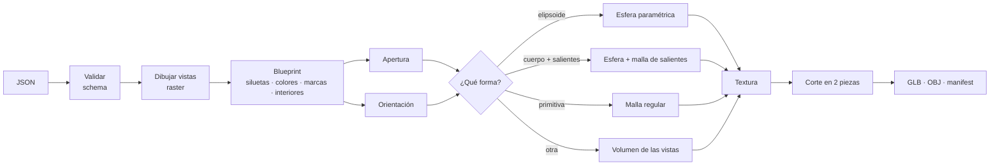

[⬅ README](../README.md)

# ⚙️ Pipeline de forma (`app/shape`)

Entrada: el **JSON del objeto** → `load_spec` → `build_blueprint` → `generate_shape(blueprint, progreso)` → `ShapeResult` (`lods`, `warnings`, `info`, `descriptor`, `texture`, `marks`).
Ejes: **X** derecha · **Y** arriba · **Z** hacia la cámara frontal. El objeto se apoya en `y = 0`.



## 🪜 Etapas

| # | Etapa | Módulo |
|---|---|---|
| 1 | Validar el JSON: `frente` + una lateral, capas, relieves, marcas | `spec/schema` |
| 2 | Dibujar cada vista (capas, texturas, tallado, contorno) y los relieves visibles | `spec/raster`, `geometry/relief` |
| 3 | Siluetas, marcas y texturas interiores → `Blueprint` | `spec/blueprint` |
| 4 | Línea de corte, bisagra, botón | `geometry/opening` |
| 5 | Orientación de las vistas | `geometry/field` |
| 6 | Decidir y generar la forma | `geometry/primitive` · `protrusion` · `ellipsoid` · `surface_nets` · `qem` |
| 7 | Textura | `geometry/ellipsoid` · `texture/atlas` · `texture/interior` |
| 8 | Cortar en pieza fija y móvil | `geometry/cut` |
| 9 | Esqueleto y pesos (si hay huesos) | `rig/skeleton` |
| 10 | Guardar | `storage/project` · `storage/export` |

## 🖌️ 1–3 · Del JSON a las siluetas (`spec`)

- Cada vista se **dibuja** en un lienzo de `CANVAS = 640` px con supermuestreo `SS = 2`; el objeto llena `FILL = 0,94` del lienzo por su medida mayor (`ppm` = píxeles por metro).
- Las capas se pintan en orden; las de `silueta: true` forman la silueta y el resto solo se pinta dentro. Con `tallado`, `carve` convierte la máscara de la capa en un campo de alturas (gaussiano), calcula la normal con la luz del JSON y **multiplica el brillo** (los colores no cambian); el grano de piedra/madera solo modula la altura dentro de la máscara.
- Si el objeto tiene `relieves`, se construyen sus mallas (`build_reliefs`) y se dibujan encima en cada vista; la textura del **cuerpo** se guarda aparte (sin los relieves).
- Se avisa si una silueta se sale del cuadro de `medidas_m` o no lo llena (±3 %).
- Las marcas se leen sin dibujar; las huellas de `salientes` sí se rasterizan como máscaras.
- `medidas_m` fija la escala real. Se normaliza con alto = 1.

## 🧭 4–5 · Apertura y orientación

| Dato | Origen |
|---|---|
| Plano de corte | `marcas.corte` (cualquier inclinación en una lateral, horizontal en `frente`/`detras`) |
| Parte móvil | `marcas.mueve`; por defecto, la de arriba |
| Bisagra | `marcas.bisagra`; por defecto, el borde trasero del corte |
| Botón | `marcas.boton`: `center`, `radius` en el frente |

`detect_orientation` prueba los volteos de las vistas lateral/cenital, puntúa cada combinación por cobertura del **casco visual** (el mínimo de las siluetas proyectadas) y elige la mejor (a igualdad, la de menos volteos); puntuación < 0,9 → aviso.

## 🧊 6 · Decisión de forma

```
fit_primitive(siluetas)  IoU ≥ 0,96 ?
 ├─ sí, e1 = e2 = 1 → ELIPSOIDE / ESFERA paramétrica
 ├─ sí, otro         → PRIMITIVA supercuádrica (4 LODs)
 └─ no → ¿cuerpo elíptico con salientes?
          ├─ sí → ESFERA + SALIENTES
          └─ no → VOLUMEN de las vistas (Surface Nets, 4 LODs)
```

| Forma | Resultado |
|---|---|
| Elipsoide / esfera | Descriptor paramétrico + textura equirrectangular; la malla (96×48) solo se exporta en el `.glb` |
| Primitiva | `primitive_mesh` regular (lados × anillos por LOD) |
| Volumen | Casco visual → (si el JSON trae `redondeo`) cada sección horizontal se recorta a una superelipse por pieza → desenfoque gaussiano (1,2 vóxeles) → Surface Nets (rejilla 88; 128 con esqueleto) → Taubin (5 it.) → decimación QEM progresiva |

El **volumen** es lo que se usa para objetos de forma libre (por ejemplo, los hechos desde imágenes): el casco visual de las siluetas, sin concavidades que las vistas no muestren.

### 🟣 Esfera + salientes y relieves (`protrusion`, `relief`)

1. **Cuerpo**: elipse robusta por vista (mínimos cuadrados con descarte de lo que sobresale) → centro y semiejes 3D. Debe encajar ≥ 80 % del contorno y coincidir entre vistas (±8 %).
2. **Salientes**: casco − cuerpo (rejilla gruesa 96 y fina 360 en su caja), limitado a la **unión de las huellas** de `marcas.salientes` (si las hay), con apertura morfológica y prolongados hacia el cuerpo para quedar unidos. Si superan el 25 % del volumen no se considera un cuerpo con salientes.
3. **Relieves del JSON** (`franja`, `cadena`, `cuerda`, `pieza`, `trazo`, `malla`): se construyen sobre la esfera siguiendo su curvatura y se hunden `EMBED = 3 mm` para que no quede rendija. Viajan con la pieza (tapa o base) a la que pertenecen; lo que cae dentro del círculo del botón va **entero con la tapa**.
4. **Textura** del cuerpo: equirrectangular horneada con el marco de la elipse de cada vista (la tapa o el cierre no se «pintan» sobre la esfera).

## 🔓 8 · Apertura (`cut`)

`split_openable`: corta la malla por el plano (los vértices del botón con z > 0 van a la tapa), exige **un único contorno**, vacía cada mitad con una cúpula interior (`WALL = 0,93`) y elige el sentido de giro que aleja la tapa. Eje X, **75°**. El plano se aplica igual al cuerpo paramétrico y a las mallas.

## 🎨 7 · Textura

| Caso | Textura |
|---|---|
| Esfera / elipsoide | Equirrectangular 512×256 (`u = atan2(x,z)/2π + 0,5`, frente en 0,5; mezcla de vistas con peso `(n·dir)⁴`); con salientes, bajo ella va el atlas de las vistas (512) |
| Malla | **Atlas** (≤ 256 px): charts de las vistas + 3 bloques de color plano; cada cara va al chart de la vista que mejor la ve |
| Interior | Sin imagen: color plano `0,25·color + 0,75·gris`. Con `interior`: celda cuadrada por pieza bajo la textura, proyectada en plano sobre el interior |

## 🦴 9 · Esqueleto (`rig`)

Las `marcas.huesos` (hasta 60, cada una con su punto en una o más vistas) se llevan a 3D, se calculan los pesos (4 influencias por vértice, suavizados sobre la superficie) y la malla se refina cerca de las articulaciones (`LOD_TOLERANCE_RIG`, rejilla 128). El visor puede mover el modelo y dibujar los huesos.

## 📉 LODs (`qem`)

Colapso de aristas con error cuádrico (Garland-Heckbert), sin dar la vuelta a triángulos ni crear geometría no-manifold. Volumen: error 0,0012 / 0,003 / 0,01 / 0,04 × tamaño, cada nivel desde el anterior. Primitivas: una malla nueva por LOD. Esfera/elipsoide: un solo nivel.

## 💾 10 · Exportación (`export`, `project`)

- **GLB** (glTF 2.0 escrito a mano): una malla por pieza, jerarquía con pivotes (`translation` relativa), piezas móviles con `extras.janus = {axis, open_angle_deg}`, un material PBR con la textura embebida.
- **OBJ + MTL** del LOD0 (pose cerrada, un grupo por pieza); la lista de Inicio reconstruye el modelo desde él.
- `save_shape` guarda el **JSON de origen** (`source/objeto.json`), vacía `shape/`, escribe los archivos y el `manifest.json` conservando las fases ya hechas.

## 👁️ Visor (`render.py`, `viewer.py`)

Sin OpenGL: `Scene` (numpy) calcula la pose abierta/cerrada (Rodrigues), ordena de lejos a cerca, sombrea `0,4 + 0,6·max(0, n·luz)` y calcula la transformación afín de textura por triángulo; `MeshViewer` lo pinta con `QPainter`. Caras interiores con sesgo de profundidad `−0,02·radio`.
